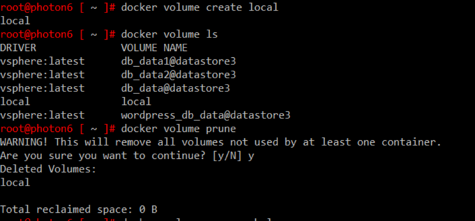
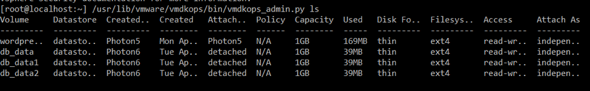

###...

# Docker Volume

```
# docker volume create --name=db_data --driver=vsphere -o size=1Gb
db_data
```

```
# docker volume ls
DRIVER              VOLUME NAME
vsphere:latest      db_data@datastore3
vsphere:latest      wordpress_db_data@datastore3

```


```
# docker volume inspect db_data
[
    {
        "Driver": "vsphere:latest",
        "Labels": {},
        "Mountpoint": "/mnt/vmdk/db_data",
        "Name": "db_data",
        "Options": {
            "size": "1Gb"
        },
        "Scope": "global",
        "Status": {
            "access": "read-write",
            "attach-as": "independent_persistent",
            "capacity": {
                "allocated": "39MB",
                "size": "1GB"
            },
            "clone-from": "None",
            "created": "Tue Apr 11 12:24:37 2017",
            "created by VM": "Photon6",
            "datastore": "datastore3",
            "diskformat": "thin",
            "fstype": "ext4",
            "status": "detached"
        }
    }
]
```


```
# docker volume rm db_data
db_data
```






